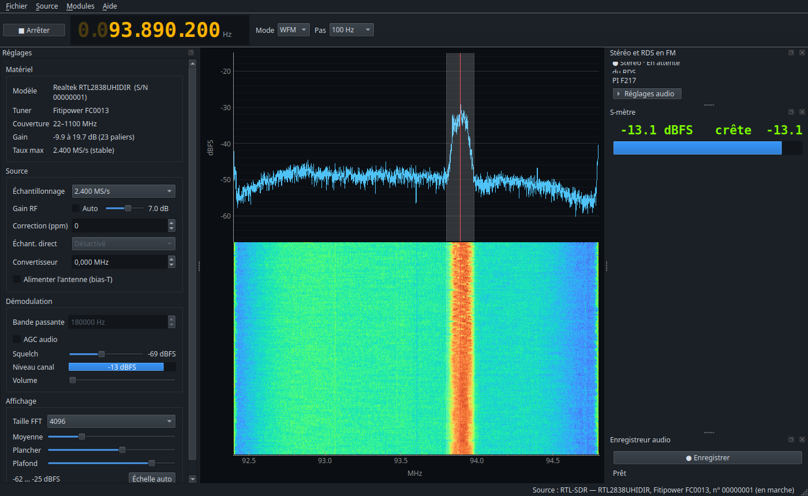
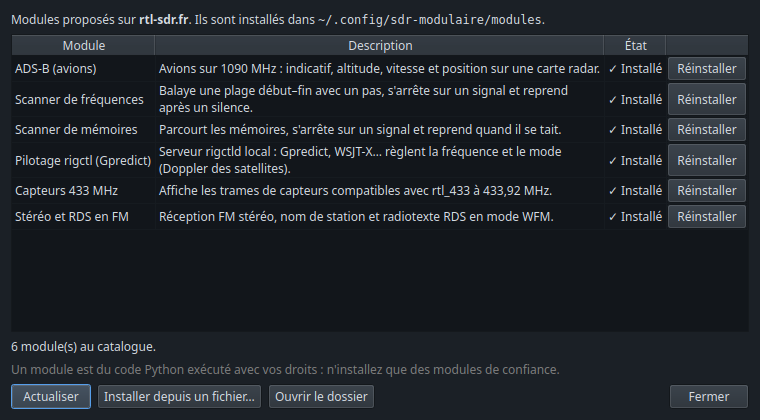

# SDR Modulaire

Récepteur SDR pour Linux, écrit en Python, construit autour d'un cœur minimal
(source → waterfall → démodulation → audio) auquel on **ajoute ou retire des
modules à chaud**, sans redémarrer.



*Réception d'une station FM avec une clé RTL-SDR (tuner FC0013), modules Stéréo et RDS, S-mètre et Enregistreur audio.*

## Ce que fait la base

- Spectre + waterfall (FFT 1024 à 16384, moyenne, plancher/plafond, échelle auto)
- Afficheur de fréquence façon transceiver : molette sur un chiffre, clic haut/bas, double-clic pour saisir
- Accord par clic sur le spectre ou le waterfall (calé sur le pas), molette = ± 1 pas, ↑/↓ et PgPréc/PgSuiv au clavier
- Modes : AM, NFM, WFM (mono, désaccentuation 50 µs), USB, LSB, CW (note 700 Hz)
- Bande passante réglable par mode (mémorisée), AGC audio, squelch en dBFS, volume
- Détection de la clé : modèle, tuner, couverture, paliers de gain, taux max ; options non prises en charge grisées, fréquence en rouge hors couverture (menu Source → Informations sur le matériel)
- RTL-SDR : taux d'échantillonnage, gain RF (auto ou manuel), correction ppm, échantillonnage direct I/Q (HF sur V3), bias-T
- Réglages, modules actifs et disposition des fenêtres retrouvés au lancement suivant

## Installation (Debian / Ubuntu)

```bash
sudo apt install rtl-sdr librtlsdr-dev libportaudio2
python3 -m venv ~/.venv/sdrmod && . ~/.venv/sdrmod/bin/activate
pip install -r requirements.txt
```

- **RTL-SDR Blog V4** : il faut le pilote `rtl-sdr-blog` (le paquet de la distribution ne gère pas le tuner R828D de la V4).
- Si l'import de pyrtlsdr échoue avec `rtlsdr_set_dithering` : `pip install pyrtlsdr==0.2.93`.
- Pense à blacklister `dvb_usb_rtl28xxu` si la clé est prise par le pilote TNT.

### Ajouter des modules

Menu **Modules → Ajouter des modules…** : les modules proposés sur rtl-sdr.fr s'installent
(et se mettent à jour) en un clic dans `~/.config/sdr-modulaire/modules/`.



## Lancement

Depuis le dossier du projet :

```bash
python3 -m sdrmod                # clé RTL-SDR
python3 -m sdrmod --debug        # avec un journal détaillé
```

## Architecture

```
source (thread lecture) ──file──> moteur (thread DSP)
                                    ├─ spectre ──────────────────────> waterfall (Qt)
                                    ├─ NCO → décimation 1 (~240 kHz) → [WFM]
                                    │        → décimation 2 (48 kHz) → [AM NFM USB LSB CW]
                                    │        → AGC / squelch → audio
                                    └─ bus : "iq", "audio", "niveau", "vfo" ──> modules
```

Les taux proposés sont tous des multiples de 48 kHz : la décimation est entière
de bout en bout, sans rééchantillonnage fractionnaire. À 2,4 MS/s, le DSP prend
environ 13 % d'un cœur.

```
sdrmod/
  moteur.py        threads lecture + DSP, publication sur le bus
  dsp.py           NCO, FIR/IIR à état, décimateurs, AGC
  bus.py           publication / abonnement
  modules.py       Module, Contexte, GestionnaireModules
  sources/         rtlsdr_source.py (une classe Source par matériel),
                   simulation.py (émetteurs fictifs, pour les tests automatiques seulement)
  demods/          am.py, fm.py, blu.py              (un fichier = un ou plusieurs modes)
  ui/              fenêtre, waterfall, afficheur, panneau, dialogue modules
modules/           smetre.py, enregistreur_wav.py, memoires.py, journal_activite.py,
                   capteurs_433.py, stereo_rds_fm.py
modules-a-telecharger/  adsb.py, scanner_memoires.py, scanner_frequences.py,
                        pilotage_rigctl.py (non chargés d'office : à copier dans ~/.config/sdr-modulaire/modules/)
tests/             test_dsp.py, test_interface.py
```

## Trois niveaux d'extension

Guide complet pour écrire un module (règles, bus, contexte, texte à donner à une IA) :
[MODULES.md](MODULES.md). Modèle à copier : `modules/_modele.py`.

**1. Ajouter un module** (le plus courant) : déposer un `.py` dans `modules/` ou
`~/.config/sdr-modulaire/modules/`, puis *Modules → Gérer les modules → Rescanner*.
Cocher pour l'ajouter, décocher (ou fermer son panneau) pour le retirer.

```python
from sdrmod.modules import Module

class MonModule(Module):
    nom = "Mon module"
    description = "Ce qu'il fait."

    def demarrer(self):
        self.abonner("audio", self.sur_audio)    # désabonnement automatique au retrait

    def sur_audio(self, echantillons, taux):     # thread DSP : rester rapide
        ...

    def creer_widget(self):                      # facultatif : panneau à droite
        ...

    def arreter(self):                           # fermer fichiers, sockets…
        ...
```

Sujets disponibles : `iq` (complex64, centre, taux), `audio` (float32 48 kHz,
taux), `niveau` (dBFS), `vfo` (fréquence, mode). Le contexte `self.ctx` permet de
lire et piloter le récepteur : `frequence()`, `mode()`, `regler_frequence()`,
`regler_mode()`, `dossier_donnees()`.

Un module qui lève une exception est retiré automatiquement ; le récepteur continue.
Le bouton *Recharger le module* relit son fichier : pratique pendant le développement.

**2. Ajouter un mode** : un fichier dans `sdrmod/demods/` avec une sous-classe de
`Demodulateur` (`nom`, largeurs, `construire()`, `traiter()`). Il apparaît dans la liste au lancement.

**3. Ajouter un matériel** : une sous-classe de `Source` dans `sdrmod/sources/`,
déclarée dans `SOURCES` (`sources/__init__.py`).

## Tests

```bash
python3 -m tests.test_dsp                                            # chaque mode sur signaux simulés
QT_QPA_PLATFORM=offscreen python3 -m tests.test_interface capture.png # interface + modules à chaud
QT_QPA_PLATFORM=offscreen python3 -m tests.test_materiel capture.png  # affichage du matériel (clé FC0013 émulée)
```

## Pistes de modules

Décodeur APRS/AX.25 (vers aprs.jerko.fr), FT8/WSPR via `jt9`, stéréo + RDS en WFM,
enregistreur IQ, scanner de mémoires, sortie MQTT vers InfluxDB/Grafana, serveur
web pour l'écoute à distance.

## Licence

Logiciel libre sous licence MIT : vous pouvez l'utiliser, le modifier et le
redistribuer librement, y compris dans un autre projet, en gardant la mention de
copyright. Voir le fichier [LICENSE](LICENSE).

Exception : `web/rtlsdr.js` (pilote WebUSB de SDR Web) est un portage de librtlsdr et reste sous
licence GPL-2.0 ou ultérieure, comme l'original.

## SDR Web

Une version navigateur (WebUSB, Chrome/Edge/Opera) est dans [web/](web/) : https://rtl-sdr.fr/sdr-web.html

Présentation du projet : https://rtl-sdr.fr/sdr-modulaire.html
